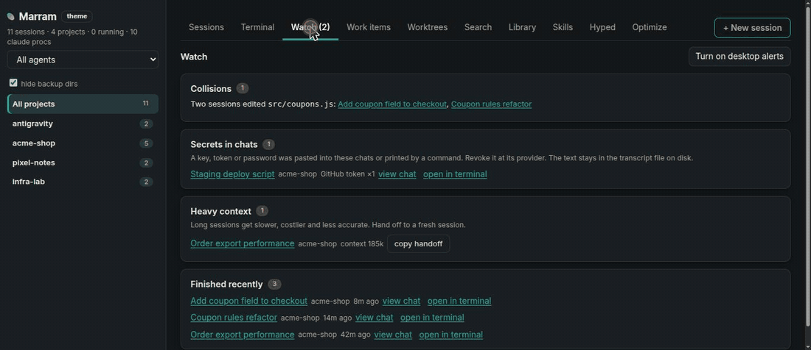

# Marram

[](https://github.com/vbvsingh29/marram/actions/workflows/ci.yml)

One local dashboard for all your AI coding agent sessions. Reads what your agents already keep on disk, runs the real agent in a browser terminal, and manages worktrees, skills, rules and secrets. No dependencies, no build step, no telemetry. Binds to `127.0.0.1` only.



*The demo uses made-up projects and sessions. Nothing in it is real data.*

## Supported agents
| Agent | List sessions | Read chat | Resume / new in terminal | Notes |
|---|---|---|---|---|
| Claude Code | yes | yes | yes | full support: worktrees, skills, changes, handoff |
| Antigravity | yes (read-only) | no | no | titles and summaries from its notes; "open folder" button. Its chats are binary |
| Codex CLI | yes | yes | yes | **experimental**: checked against Codex's open-source protocol and a public sample session, not a live install. Run `node server.js --diagnose codex` to print a text-free structure summary for a bug report |

Use the agent dropdown in the sidebar to filter. Agents that are not installed are greyed out.

## Features
- **Sessions** across all projects, grouped by repo with worktrees nested. Status (active / later / revisit / done / closed, closed can be reopened), notes, feature / bug / chore type, pins, list and board views. A strip at the top shows your pinned sessions and what you touched last.
- **Ctrl+K command palette** to jump to any session, project or tab, or run an action. **Select** several sessions to tag them at once.
- **+ New session**: pick an agent and a folder (optionally in a fresh git worktree), then work in the real terminal (xterm.js). Split view shows two terminals side by side. A **Prompts** menu inserts your saved prompts.
- **Attach images and documents**: paste a screenshot, drop a file on the terminal, or press Attach. The file is saved privately on this computer (25 MB limit, images, PDF, text, Office files) and its path is typed for the agent.
- **Watch**: sessions waiting for you, two sessions editing the same file or folder, secrets pasted into chats, heavy context. Optional desktop alerts when a session ends.
- **Daily update**: a plain-language summary of what you worked on (today, yesterday or the week), ready to paste into Slack or a meeting.
- **Chat viewer**, full-text search, and a **changes** view per session with files, commits and the pull request and its checks (GitHub).
- **Work items**: sessions grouped by ticket id (optional Jira link), GitHub issue / PR, or your own type tag.
- **Worktrees**: scan, filter and remove idle, dirty or missing worktrees safely.
- **Library**: global and per-project rules (`CLAUDE.md`), skills, saved prompts, a decisions note that is added to new sessions, a secrets vault (injected as environment variables into sessions started here), and backup / restore.
- **Skills** and **Hyped**: usage, enable per folder, discover / preview / install skills from GitHub.
- **Optimize**: big and forgotten sessions, token counts and optional costs from your own prices, processes and memory, and opt-in stopping of idle sessions.
- **Messaging**: send a message to Slack (a channel or a person, through a bot token you create), to any incoming webhook (Slack, Teams, Discord, other), or open a ready draft in Gmail, Outlook, Outlook.com, your mail app or a Teams chat. Every send shows who it goes to and asks you to confirm; drafts are opened in your own app, so Marram stores no mail or Teams sign-in. Library shows what is connected.
- **Custom agents**: add any command-line tool (aider, gemini, opencode, your own script) and run it in the terminal from "+ New session".
- **Close for good**: stops a session's process and deletes its chat after you type `DELETE`. It cannot be undone.
- **Read-only mode** for demos and screen sharing, and a small activity log of what Marram itself did.
- Deep links for every view, e.g. `#/sessions?a=antigravity`, `#/work`, `#/sessions?chat=<session id>`.

## Platforms
Linux is the tested platform. macOS is covered by the test suite in CI; live "running" detection there relies on the session files Claude writes, so it is less exact. Windows runs the dashboard and tests, but the terminal view needs a Unix pty: use WSL. CI results are the source of truth.

## Run
Requires Node 20+, `git`, `python3` (terminal view) and at least one agent CLI (`claude`, `codex`) or Antigravity data on this machine. Optional: `gh` for PR info.

```
node server.js          # http://127.0.0.1:7777 (in a terminal it prints the sign-in link)
npx github:vbvsingh29/marram   # run without cloning
node server.js --url    # prints the one-time sign-in link; open it once per browser
```

Config (environment variables): `PORT` (default 7777), `IDLE_DAYS` (default 30), `JIRA_BASE` and `TICKET_PREFIXES` to link ticket ids. See `marram.service.example` to run it at login with systemd.

## Security model
It binds to `127.0.0.1` only, rejects other `Host` headers, and requires a sign-in: a random 256-bit token in `~/.claude/hub-token` (mode 600), exchanged once via `?k=` for an HttpOnly, SameSite=Strict cookie. Every API call also needs an `x-hub: 1` header, and the page is served with a strict CSP. It can start `claude` in folders under your home directory, delete worktrees you pick, and edit CLAUDE.md files, so do not expose it to a network or reverse-proxy it. Transcripts can contain secrets you pasted into chats; the viewer shows them as stored.

## Data it writes
`~/.claude/session-tags.json`, `~/.claude/hub-config.json`, `~/.claude/hub-notes.json`, `~/.claude/hub-snippets.json`, `~/.claude/hub-activity.json`, `~/.claude/hub-vault.json` (secrets, mode 600, plain text like `~/.git-credentials`), `~/.claude/hub-skills/`, `~/.claude/hub-cache/`, `~/.claude/hub-backups/`. It never edits transcripts (the terminal's "resume from another folder" copies one).

## Tests
```
npm test
```
Uses Node's built-in test runner with a temporary HOME, so it never touches your real `~/.claude`.

## Layout
`server.js` (bootstrap) -> `lib/routes.js` (HTTP) -> `lib/{skills,worktrees,system}.js` -> `lib/sessions.js` -> `lib/core.js`; `index.html` is the whole UI; `pty-helper.py` backs the terminal view; `agents/skill-advisor.md` is an optional Claude Code subagent.
